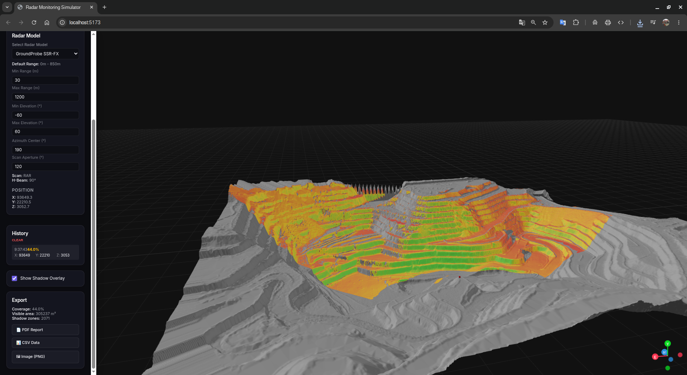
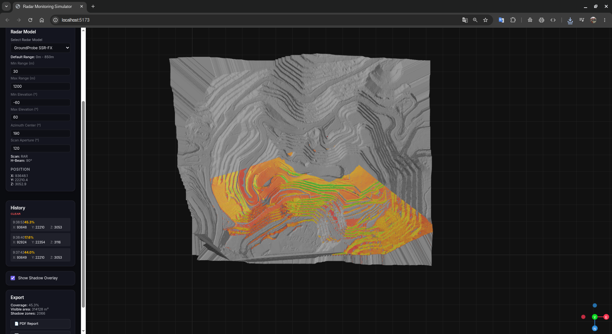
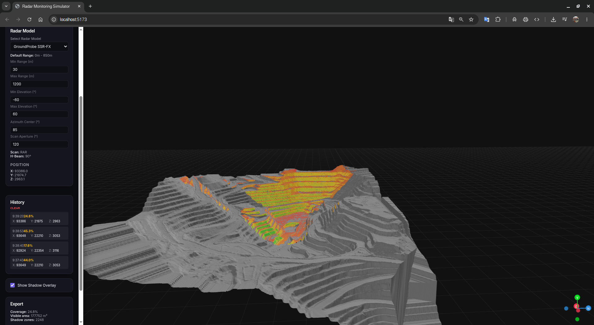
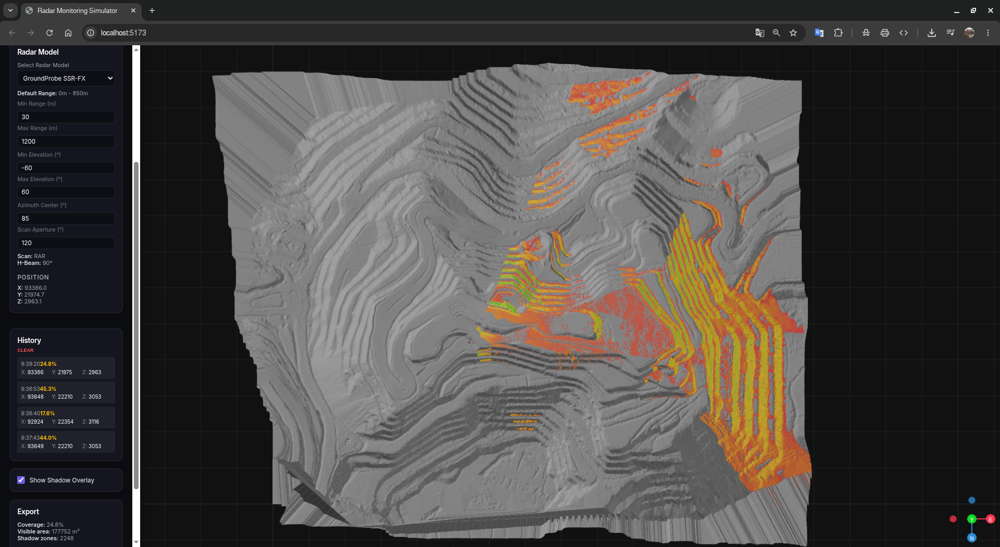
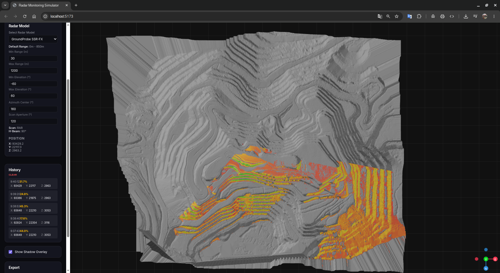

# 📡 GeotRadarSim — Simulador de Cobertura de Radar para Monitoreo Geotécnico

**Herramienta gratuita, de código abierto y basada en navegador para simular la cobertura de radares de monitoreo de taludes en topografías mineras reales.**

> [Read in English 🇬🇧](README.md)

> Creado por un ingeniero geotécnico, para ingenieros geotécnicos.  
> Porque las decisiones de posicionamiento de radares deben basarse en datos — no en la intuición.

🌐 **Aplicación en vivo:** [https://nibaldox.github.io/GeotRadarSim/](https://nibaldox.github.io/GeotRadarSim/)

---

## El Problema

En la minería a cielo abierto, los radares de monitoreo de taludes (SSR de GroundProbe, MSR de Reutech, IBIS de IDS, etc.) son críticos para la estabilidad de taludes y la seguridad operacional. Decidir **dónde** colocarlos a menudo se hace observando la topografía del rajo/pit en softwares como Vulcan o Datamine, intentando calcular mentalmente:

- ¿Qué sectores del talud puede realmente **"ver"** el radar?
- ¿Existen crestas o bancos que generan **zonas ciegas (sombras)**?
- A una distancia de 2,500 m, ¿la **calidad de la señal (SNR)** sigue siendo aceptable?
- Si despliego un **segundo radar**, ¿logra cubrir los vacíos de cobertura?

Este ejercicio visual en 3D es propenso a errores. Existen herramientas comerciales para este propósito, pero sus licencias son costosas y no siempre están al alcance de todos los ingenieros en faena.

**GeotRadarSim resuelve esto.** Es completamente gratuito, se ejecuta directamente en tu navegador sin instalar nada y te da respuestas precisas en segundos.

---

## Características

| Característica | Descripción |
|---|---|
| 🗺️ **Topografía Real** | Carga curvas de nivel en DXF o mallas STL desde los levantamientos de topografía de tu mina |
| 🏗️ **Terreno Sintético** | Genera terrenos montañosos de ejemplo al instante para pruebas rápidas |
| 📡 **Análisis de Línea de Visión (LOS)** | Análisis de trazado de rayos con mapa dinámico de calidad de señal (SNR) |
| 🎯 **Parámetros de Radar** | Configura límites y overrides de rango, elevación y azimut por cada análisis |
| 🔴 **Red Multi-Radar** | Fusión dinámica de múltiples coberturas de radar mediante casillas en el historial |
| 🧮 **Síntesis Vectorial 3D** | Resolvedor analítico de Moore-Penrose que reconstruye vectores de desplazamiento reales en 3D a partir de lecturas 1D (LOS) |
| 📊 **Métricas de Cobertura** | Cálculo instantáneo de % de cobertura, área visible ($m^2$), recuento de zonas ciegas y sensibilidad geométrica |
| 🕓 **Historial Interactivo** | Activa o desactiva casillas en el historial para fusionar coberturas en sub-milisegundos, o presiona "X" para eliminar |
| 📄 **Reporte PDF** | Genera reportes estructurados con tablas y métricas listos para impresión |
| 📋 **Exportación CSV** | Descarga la cuadrícula completa de calidad en formato tabular para post-procesamiento |
| 🖼️ **Captura PNG** | Captura la vista actual del visor 3D como imagen de alta resolución |
| 🌐 **100% en Navegador** | Sin servidores, sin bases de datos externas, procesado local de forma segura |

---

## Capturas de Pantalla

### Análisis Completo de Cobertura de Radar
Carga la topografía real de tu mina (STL o DXF), coloca el radar en cualquier punto y observa al instante qué taludes están cubiertos. El gradiente de color indica la calidad de la señal (Verde = Excelente, Amarillo/Naranja = Moderada, Rojo = Pobre).



### Cobertura desde Diferentes Ángulos
Rota y explora el modelo 3D para identificar bancos bloqueados y sombras físicas detrás de crestas o rampas desde cualquier perspectiva.



### Comparación de Posiciones de Radar
Haz clic en distintas lomas o plataformas para comparar la ganancia de cobertura. Cada análisis se registra automáticamente en el panel de Historial.



### Identificación de Zonas de Sombra
Visualiza con precisión quirúrgica cuáles bancos y bermas se encuentran fuera del haz del radar.



### Análisis de Red Multi-Radar
Combina la señal de múltiples radares desplegados en diferentes sectores del rajo para obtener el mapa de cobertura unificado de la mina.



---

## Inicio Rápido

### En Línea (Recomendado)
Simplemente abre [https://nibaldox.github.io/GeotRadarSim/](https://nibaldox.github.io/GeotRadarSim/) — no requiere descargas ni configuraciones.

### Ejecución Local (Desarrolladores)
```bash
git clone https://github.com/nibaldox/GeotRadarSim.git
cd GeotRadarSim/frontend
npm install
npm run dev
```
Abre [http://localhost:5173/GeotRadarSim/](http://localhost:5173/GeotRadarSim/) en tu navegador.

---

## Cómo Usar

### Análisis de un Solo Radar (3 pasos)
1. **Cargar Terreno** — Sube tu archivo DXF o STL, o haz clic en *Generate Synthetic Terrain*.
2. **Configurar Radar** — Selecciona el modelo de radar y define overrides opcionales de rango, elevación o apertura.
3. **Hacer Clic en el Terreno** — Coloca el radar de forma interactiva; el análisis se ejecutará automáticamente.

### Análisis de Red Multi-Radar
1. **Desplegar Radares** — Configura y coloca un radar en el terreno. Este se calculará y registrará automáticamente en el historial.
2. **Marcar Casillas** — En el panel de **Historial**, activa las casillas de verificación de los análisis que deseas fusionar.
3. **Fusión Instantánea** — Las coberturas se fusionarán en vivo en el shader del visor 3D en menos de 1 milisegundo, recalculando las métricas globales automáticamente.
4. **Limpieza** — Haz clic en el botón **"X"** de cualquier tarjeta en el historial para eliminar análisis obsoletos.

### Síntesis Vectorial 3D y Mapa de Sensibilidad
1. **Activar Red** — Marca **al menos 2** análisis de radar en el panel de **Historial**.
2. **Seleccionar Capa** — Alterna al modo **Sensibilidad (3D)** en el panel *Síntesis Vectorial 3D*.
3. **Calcular Sensibilidad** — Haz clic en **"🗺️ Calcular Mapa de Sensibilidad 3D"** para teñir el terreno con el índice de sensibilidad geométrica ($S_v$). Las zonas ciegas físicas de los radares se enmascaran automáticamente como transparentes.
4. **Simular Deslizamiento (Doble Clic)** — Da doble clic en cualquier punto de la ladera del visor 3D para inducir un vector de falla gravitacional local. El solver analítico de mínimos cuadrados (Moore-Penrose) calculará instantáneamente:
   * **Vector Real de Desplazamiento** (magnitud y dirección 3D inducidas).
   * **Lectura Aparente (1D)** que registraría el radar seleccionado, reflejando la pérdida geométrica por desalineación ($-\%$) en la línea de visión.
   * **Vector Reconstruido en 3D**, alertando sobre alineaciones singulares o zonas ciegas vectoriales de la red de radares.

---

### Modelos de Radar Soportados

| Modelo | Rango Máx | Tipo de Escaneo | Notas |
|---|---|---|---|
| GroundProbe SSR-FX | 850 m | RAR | Radar de apertura real de gran estabilidad |
| IBIS-ArcSAR360 | 2500 m | 360° SAR | Apertura sintética circular de gran cobertura |
| Reutech MSR | 500 m | RAR | Apertura de 120° de rápido escaneo |

---

## Formatos de Archivos Soportados

| Formato | Extensión | Exportación sugerida desde Vulcan / Datamine |
|---|---|---|
| Contornos DXF | `.dxf` | Exporta curvas de nivel o polilíneas 3D con elevación Z real |
| Malla STL | `.stl` | Exporta la superficie triangulada como malla (ASCII o binaria) |

> ⚠️ **Importante para DXF:** Asegúrate de exportar como polilíneas 3D. Los archivos DXF en 2D plano (sin valores Z de elevación) generarán una topografía completamente plana.

---

## Arquitectura Técnica

```
Ejecutado al 100% en el Navegador Local — Sin Servidores Externos
┌─────────────────────────────────────────────────┐
│  React + R3F (Three.js)                         │
│  ┌────────────────┐  ┌───────────────────────┐  │
│  │ Terrain Worker │  │    LOS Worker         │  │
│  │ (Web Worker)   │  │    (Web Worker)       │  │
│  │ Parse DXF/STL  │  │  Trazado Rayos + SNR  │  │
│  │ Binning 1D IDW │  │  Merge en Sub-1ms     │  │
│  └────────────────┘  └───────────────────────┘  │
│  Zustand (Estado) ·  jsPDF (Exportaciones)      │
└─────────────────────────────────────────────────┘
```

* **Procesamiento de Terreno**: Ingestión de DTM mediante un resolvedor IDW optimizado con contenedores espaciales enteros 1D en un Web Worker independiente para evitar el bloqueo del hilo de React.
* **Motor de Raycasting**: Trazado de rayos y cálculo de SNR en paralelo usando buffers planos de floats (`Float32Array`) transferidos como *Transferable Objects* de zero-copy.
* **Carga GPU de Cero Alocación**: La textura de sombras (`THREE.DataTexture`) se vincula directamente a los shaders de la GPU a partir del buffer plano del Worker, omitiendo bucles de desempaquetado en la CPU.
* **Fusión de Cobertura ultra-veloz**: El algoritmo de unión (OR lógico + Max SNR) recorre la memoria plana en 1D unificando coberturas en menos de **1 milisegundo**.

---

## Limitaciones Conocidas

- La compatibilidad con DXF depende de la estructura de polilíneas 3D. Algunos formatos CAD altamente complejos pueden requerir simplificación previa.
- Terrenos masivos (>8192×8192 celdas) pueden verse ralentizados por límites físicos de texturas de las tarjetas gráficas.
- Requiere aceleración por hardware WebGL habilitada en el navegador (Chrome o Firefox recomendados).

---

## Hoja de Ruta (Roadmap)

- [ ] Visualización de isolíneas y vista en plano 2D clásica.
- [ ] Representación visual en 3D del cono del haz de radar.
- [ ] Tabla comparativa detallada de métricas de redes de radar.
- [ ] Importación y exportación de redes de radares mediante JSON.
- [ ] Editor integrado para crear y configurar modelos de radar personalizados.
- [ ] Maquetación adaptativa completa para dispositivos móviles.

---

## Contribuir

¡Las contribuciones son bienvenidas! Al ser una herramienta operativa utilizada en faenas reales, la precisión física y la estabilidad matemática tienen máxima prioridad sobre la velocidad de desarrollo de nuevas características.

```bash
# Ejecutar pruebas unitarias
cd frontend && npm test

# Compilación de producción
npm run build
```

---

## Licencia

MIT — Libre para usar, modificar y distribuir comercial o académicamente.

---

## Sobre el Proyecto

Diseñado y construido por un ingeniero geotécnico de faena, cansado del costo y la inaccesibilidad de las licencias de softwares comerciales para la planificación y optimización de redes de monitoreo.  
Si esta herramienta te ayuda a tomar una mejor decisión de posicionamiento o a proteger la vida de los operadores en el rajo, el objetivo estará cumplido.

¿Sugerencias o bugs? Crea un reporte en → [GitHub Issues](https://github.com/nibaldox/GeotRadarSim/issues)
