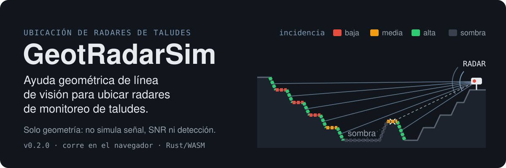
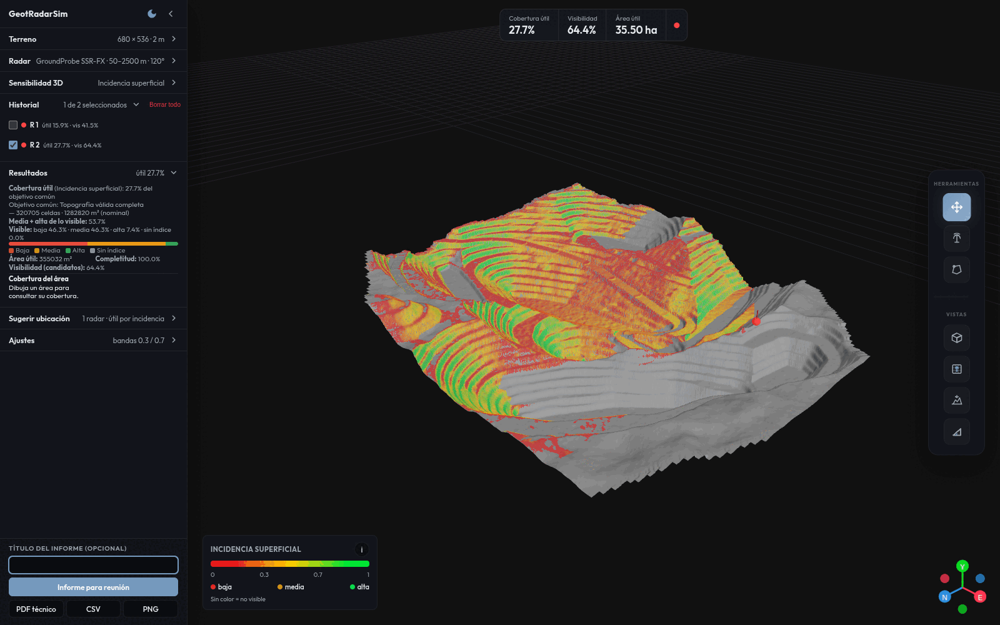
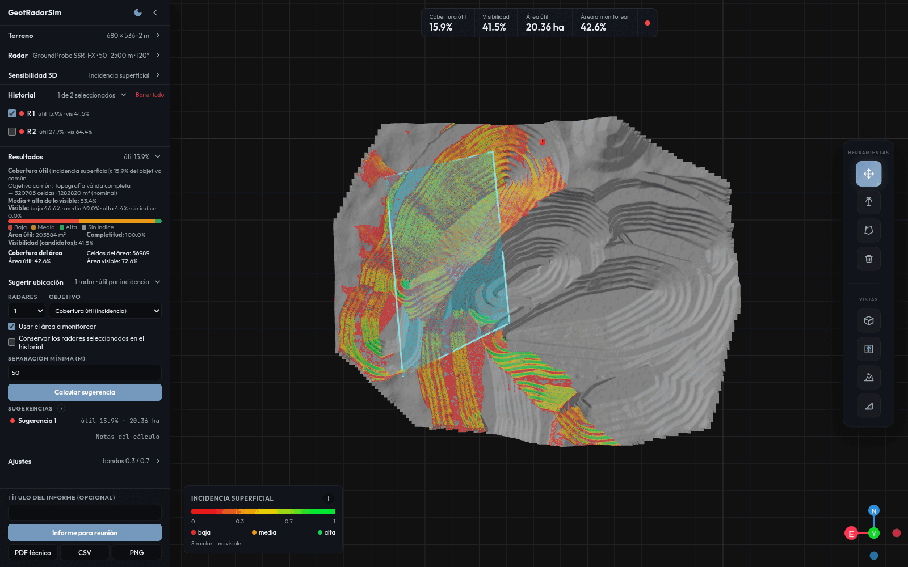
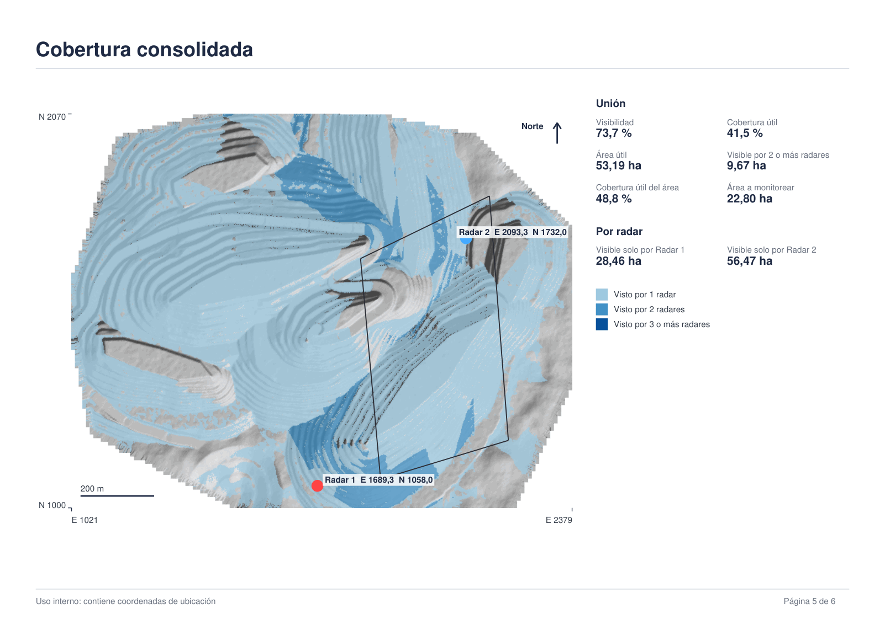

<p align="center">
  
</p>

<p align="center">
  <a href="https://nibaldox.github.io/GeotRadarSim/"><b>Abrir la aplicación</b></a> ·
  <a href="README.md">Read in English</a> ·
  <a href="docs/tecnico.md">Referencia técnica</a>
</p>

GeotRadarSim ayuda a geotécnicos e ingenieros de monitoreo a decidir dónde ubicar un radar de monitoreo de taludes.
Cargas la topografía del rajo, ubicas un radar y ves qué taludes ve en línea recta, cuáles quedan en sombra y qué tan
bien orientado está cada talud visible respecto del radar.

> [!IMPORTANT]
> Es una ayuda geométrica, no un simulador de radar. **No** calcula señal, SNR ni probabilidad de detección. La
> decisión de ubicación requiere además datos del fabricante y validación en terreno.

## Cómo se ve

https://github.com/user-attachments/assets/62386926-9e7e-4529-bf8e-1f565ffe0fa1

<p align="center"><sub>Recorrido de 80 segundos, sin voz. Los cálculos acelerados están rotulados en pantalla.</sub></p>

<p align="center">
  
</p>

<p align="center">
  
  
</p>

<p align="center"><sub>Todas las imágenes usan el rajo sintético incluido («Terreno sintético»), no una mina real.</sub></p>

## Qué hace

- **Línea de visión por celda.** Cada celda del terreno se clasifica como visible, en sombra, fuera de rango, fuera
  del campo de visión o sin datos, según la posición y los límites del radar que configures.
- **Capas de calidad.** Las celdas visibles se pintan por incidencia superficial o por la proyección de un movimiento
  supuesto de máxima pendiente, con bandas de calidad ajustables.
- **Área a monitorear.** Dibujas un polígono sobre el terreno y ves qué parte es visible y qué parte tiene cobertura
  útil.
- **Sugerencia de ubicación.** «Sugerir ubicación» propone de 1 a 4 posiciones de radar y comprueba cada una con el
  cálculo completo de línea de visión.
- **Varios radares.** Combinas análisis del historial para ver la cobertura conjunta.
- **Informe y exportes.** «Informe para reunión» genera un PDF con portada 3D, tabla de radares y mapas; también hay
  PDF técnico, CSV y PNG.

## Pruébalo en 1 minuto

1. Abre [la aplicación](https://nibaldox.github.io/GeotRadarSim/) y presiona **Terreno sintético** para cargar el
   rajo de ejemplo.
2. En **Radar**, elige un modelo. Activa la herramienta **Agregar radar** del visor y haz clic en una cresta.
3. Lee la cobertura: los colores del terreno, la barra de cifras sobre el visor y **Resultados**.
4. Activa la herramienta **Área a monitorear**, haz clic alrededor de una pared y cierra el área con doble clic.
5. Abre **Sugerir ubicación** y presiona **Calcular sugerencia**.
6. Presiona **Informe para reunión**, al pie de la barra lateral, para descargar el PDF.

Para usar tu propia topografía, carga un archivo DXF o STL con **Cargar STL / DXF**.

## Cómo funciona

```text
Archivo DXF / STL, o el rajo de ejemplo
  ↓  Worker de terreno: grilla regular de elevación (IDW)
  ↓  Worker de LOS, Rust → WebAssembly: un rayo recto por celda
  ↓  capas de calidad: incidencia superficial, proyección del movimiento
  ↓  cifras, cobertura del área, sugerencia de ubicación
  →  informe para reunión, PDF técnico, CSV, PNG
```

La línea de visión es un rayo recto sobre los triángulos de la grilla del terreno. Los estados de celda, las fórmulas
de las métricas, las bandas de calidad, las columnas del CSV y los límites de la grilla están en la
[referencia técnica](docs/tecnico.md).

## Qué no es

- No es un modelo RF: no considera propagación, atenuación, SNR, probabilidad de detección ni resolución del radar.
- Los perfiles de radar incluidos son valores por defecto editables, no especificaciones del fabricante.
- Los resultados dependen de la topografía de entrada y de la resolución de la grilla.
- Las coordenadas usan el marco propio del terreno; la aplicación no guarda datum ni zona.
- La sugerencia de ubicación no tiene garantía de optimalidad para el objetivo de proyección del movimiento.

## Privacidad

Todo corre en el navegador; no hay un servidor de análisis. La compilación de producción fija una política de
seguridad de contenido con `connect-src 'self'`, así que la aplicación no puede enviar el terreno ni los resultados a
orígenes externos.

## Ejecutar en local

Requisitos: Node.js 24, la versión de Rust fijada en `rust/rust-toolchain.toml` (con el target
`wasm32-unknown-unknown`) y `wasm-bindgen-cli` en la versión de `rust/Cargo.lock`.

```bash
git clone https://github.com/nibaldox/GeotRadarSim.git
cd GeotRadarSim/frontend
npm ci
npm run dev        # compila el núcleo WebAssembly y luego inicia Vite
```

Abre <http://localhost:5173/GeotRadarSim/>.

Pruebas:

```bash
cd frontend && npm test && npm run build
cd ../rust
cargo fmt --check
cargo clippy --all-targets --locked -- -D warnings
cargo test --locked
```

## Hoja de ruta

- [ ] Etiquetas de curvas de nivel en el visor
- [ ] Visualización del cono del haz del radar
- [ ] Importar y exportar la configuración de una red de radares (JSON)
- [ ] Perfiles de radar personalizados guardados
- [ ] Diseño para móviles

## Contribuir

Las issues y los pull requests son bienvenidos en [GitHub Issues](https://github.com/nibaldox/GeotRadarSim/issues).
Importan más la exactitud del contrato geométrico, el manejo explícito de datos faltantes y un comportamiento
reproducible que las afirmaciones físicas o de rendimiento sin evidencia.

## Licencia

MIT — ver [LICENSE](LICENSE).
