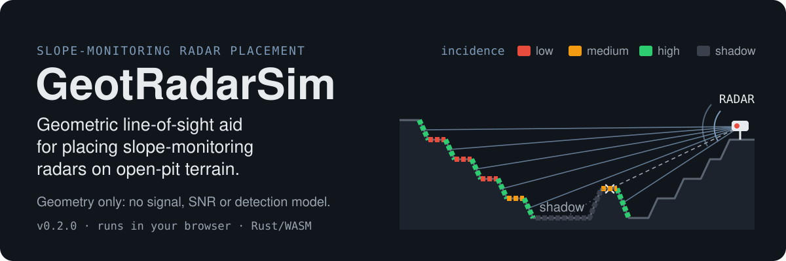
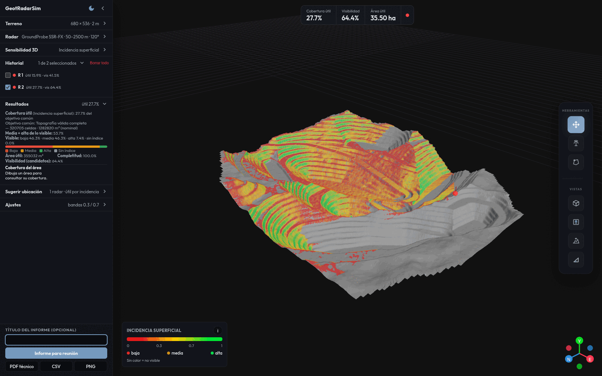
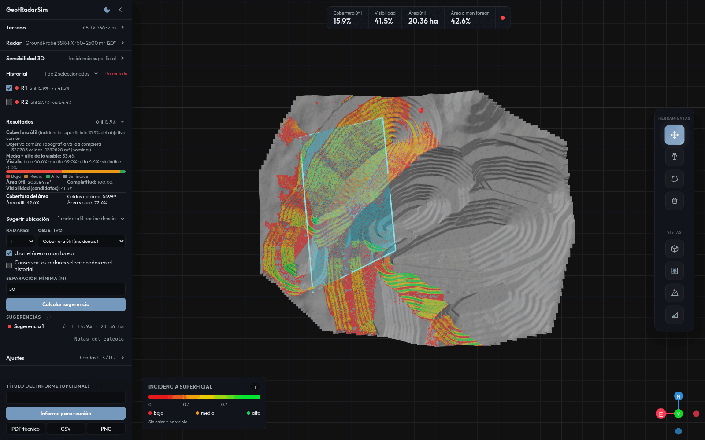
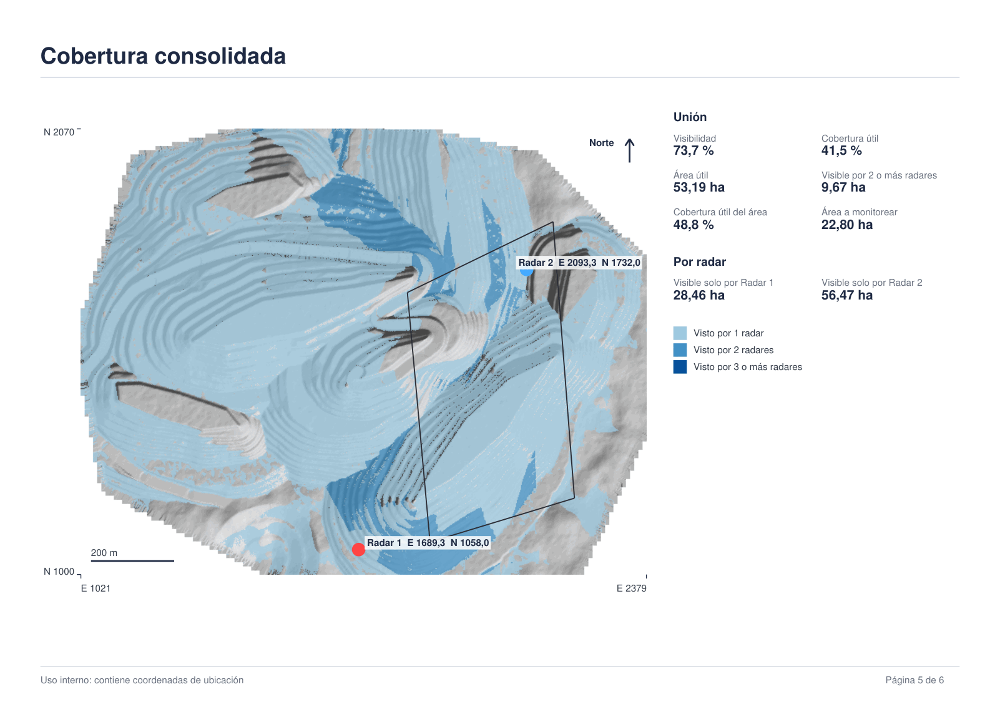

<p align="center">
  
</p>

<p align="center">
  <a href="https://nibaldox.github.io/GeotRadarSim/"><b>Open the app</b></a> ·
  <a href="README.es.md">Leer en español</a> ·
  <a href="docs/technical.md">Technical reference</a>
</p>

GeotRadarSim helps geotechnical and slope-monitoring engineers decide where to place a slope-monitoring radar. Load
the pit topography, place a radar, and see which slopes it can see in a straight line, which stay in shadow, and how
well each visible slope faces the radar.

> [!IMPORTANT]
> It is a geometric aid, not a radar simulator. It does **not** calculate signal strength, SNR or detection
> probability. A placement decision still needs manufacturer data and validation in the field.

## See it working

https://github.com/user-attachments/assets/10edac28-2e79-44cb-8682-89845da2f480

<p align="center"><sub>80-second tour, no voice. Captions in English; the app itself is in Spanish. Sped-up computations are labelled on screen.</sub></p>

<p align="center">
  
</p>

<p align="center">
  
  
</p>

<p align="center"><sub>All images use the bundled synthetic pit («Terreno sintético»), not a real mine.</sub></p>

## What it does

- **Line of sight per cell.** Each terrain cell is classified as visible, in shadow, out of range, outside the field
  of view or without data, for the radar position and limits you set.
- **Quality layers.** Visible cells are painted by surface incidence or by the projection of an assumed
  maximum-slope movement, with quality bands you can adjust.
- **Area to monitor.** Draw a polygon on the terrain and get how much of it is visible and usefully covered.
- **Placement suggestion.** «Sugerir ubicación» (suggest location) proposes 1–4 radar positions and checks each one
  with the full line-of-sight calculation.
- **Several radars.** Combine analyses from the history to see the joint coverage.
- **Meeting report and exports.** «Informe para reunión» (meeting report) builds a PDF with a 3D cover, a radar table
  and maps; a technical PDF, CSV and PNG are also available.

## Try it in one minute

1. Open [the app](https://nibaldox.github.io/GeotRadarSim/) and press **Terreno sintético** (synthetic terrain) to
   load the example pit.
2. In **Radar**, choose a model. Pick the **Agregar radar** (add radar) tool in the viewer and click a crest.
3. Read the coverage: the colours on the terrain, the figures bar above the viewer and **Resultados** (results).
4. Pick the **Área a monitorear** (area to monitor) tool, click around a wall and double-click to close the area.
5. Open **Sugerir ubicación** and press **Calcular sugerencia** (compute suggestion).
6. Press **Informe para reunión** at the bottom of the sidebar to download the PDF.

To use your own topography, load a DXF or STL file with **Cargar STL / DXF**.

## How it works

```text
DXF / STL file, or the example pit
  ↓  Terrain Worker: regular elevation grid (IDW)
  ↓  LOS Worker, Rust → WebAssembly: one straight ray per cell
  ↓  quality layers: surface incidence, movement projection
  ↓  figures, area coverage, placement suggestion
  →  meeting report, technical PDF, CSV, PNG
```

The line of sight is a straight ray over the triangles of the terrain grid. Cell states, metric formulas, quality
bands, CSV columns and grid limits are described in the [technical reference](docs/technical.md).

## What it is not

- Not an RF model: no propagation, attenuation, SNR, detection probability or radar resolution.
- The bundled radar profiles are editable software defaults, not manufacturer specifications.
- Results depend on the input topography and the grid resolution.
- Coordinates use the terrain's own frame; the app does not store a datum or zone.
- Placement suggestions are not guaranteed to be optimal for the movement-projection objective.

## Privacy

Everything runs in your browser; there is no analysis server. The production build sets a Content Security Policy
with `connect-src 'self'`, so the app cannot send your terrain or results to external origins.

## Run locally

Requirements: Node.js 24, the Rust toolchain pinned in `rust/rust-toolchain.toml` (with the
`wasm32-unknown-unknown` target) and `wasm-bindgen-cli` at the version in `rust/Cargo.lock`.

```bash
git clone https://github.com/nibaldox/GeotRadarSim.git
cd GeotRadarSim/frontend
npm ci
npm run dev        # builds the WebAssembly core, then starts Vite
```

Open <http://localhost:5173/GeotRadarSim/>.

Tests:

```bash
cd frontend && npm test && npm run build
cd ../rust
cargo fmt --check
cargo clippy --all-targets --locked -- -D warnings
cargo test --locked
```

## Roadmap

- [ ] Contour labels in the viewer
- [ ] Radar beam-cone visualization
- [ ] Import/export of a radar network configuration (JSON)
- [x] Saved custom radar profiles
- [ ] Mobile layout

## Contributing

Issues and pull requests are welcome at [GitHub Issues](https://github.com/nibaldox/GeotRadarSim/issues). Accuracy of
the geometric contract, explicit no-data handling and reproducible behaviour matter more than physical or performance
claims without evidence.

## License

MIT — see [LICENSE](LICENSE).
